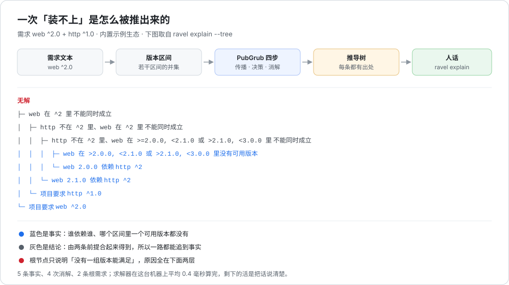

# Ravel

依赖版本求解器。它做两件事：把一组需求解成一组确定的版本；解不出来时，把「为什么」一步步讲清楚。

[](https://github.com/18971181532/ravel/actions/workflows/tests.yml)

大多数包管理器在装不上时只说一句「依赖冲突」。Ravel 会给你一段能读的论证：

```
$ ravel explain "web ^2.0" "http ^1.0"
无解。一步步推导如下：

  1. web 在 >2.0.0, <2.1.0 或 >2.1.0, <3.0.0 里没有可用版本
  2. web 2.0.0 依赖 http ^2
  3. web 2.1.0 依赖 http ^2
  4. 项目要求 http ^1.0
  5. 项目要求 web ^2.0
  6. 由 1、2 可得：http 不在 ^2 里、web 在 >=2.0.0, <2.1.0 或 >2.1.0, <3.0.0 里 不能同时成立
  7. 由 6、3 可得：http 不在 ^2 里、web 在 ^2 里 不能同时成立
  8. 由 7、4 可得：web 在 ^2 里 不能同时成立
  9. 由 8、5 可得：没有任何一组版本能同时满足全部需求

结论：没有任何一组版本能同时满足全部需求。

可以试试：
  · 去掉需求 `web ^2.0` 就能装上
  · 把 `web ^2.0` 放宽成 `web` 就能装上，会选 web 1.0.0
  · 去掉需求 `http ^1.0` 就能装上
```

每一条都落在事实上：谁依赖谁、哪个区间里一个版本都没有。没有「请检查你的依赖」这种废话，也没有需要你自己去猜的地方。



## 这个项目想证明什么

依赖求解是个看起来简单、写起来处处是坑的问题。一个能跑通 demo 的求解器和一个能用的求解器之间，隔着三件事，这个项目把三件事都做了：

1. **答案必须是对的。** 求解器用 PubGrub 算法，结论拿暴力枚举当裁判——随机造几千个小生态穷举所有组合，一边说「有解」另一边说「无解」就立刻失败。开发时用一次性脚本对拍过 12000 组随机 registry，零不一致；仓库里留下的是缩小版（120 组），保证 CI 跑得快。
2. **失败必须能解释。** 冲突消解的过程会顺手搭出一棵推导树（每一层记着「我是由哪两条前提合出来的」），`explain` 只是把这棵树按先因后果摊平。所以解释不是另写的一套说辞，而是求解过程的副产品——它不可能和结论对不上。
3. **数字必须是真的。** README 里出现的每个数字、每段输出都是真跑出来的，命令都写在旁边。

## 功能

| 能力 | 说明 |
| --- | --- |
| 求解 | PubGrub：传播、决策、冲突消解、失败，带启发式选包（候选最少的先定） |
| 解释失败 | 把推导树摊成 1..n 的步骤，每步标注引用了前面哪几条；再给「放宽/去掉哪条需求就能装上」的建议 |
| 树形视图 | 同一棵树换个画法：结论在上、事实在末梢，一眼看出哪两条撞在一起 |
| 解释成功 | 列出选了哪些版本，以及**为什么不是更新的版本**（被哪条约束排除、自己依赖打架、还是预发布没点名） |
| 版本区间代数 | `VersionRange` 是若干区间的并集，构造时规范化，交/并/补/差全部支持，所以「区间相等」就等于「版本集合相等」 |
| 约束语法 | `^1.2.3`、`~1.2`、`1.2.*`、`>=1.0, <2.0`、`!=1.5.0`、`*`、`a \|\| b` |
| SemVer 2.0 | 预发布标识参与比较，构建元数据不参与相等与排序 |
| 预发布规矩 | 预发布版本只有被约束点名才参与选择（和 npm 一致），`^2.0` 不会悄悄装 `2.1.0-rc.1` |
| 撤回版本 | `yanked` 的版本直接跳过，永远不会被选中 |
| 锁文件 | `ravel lock` 写出一份 JSON，`ravel check` 在新的 registry 上重新核对：版本还在不在、依赖还满足不满足、有没有更新的版本被错过 |
| 可编程 | 全部能力都是纯函数式的 Python API，命令行只是薄薄一层 |
| 零依赖 | 只用标准库，没有编译步骤，不联网 |

## 环境与依赖

- **Python 3.10 及以上**（用到了 `X | Y` 类型标注、`dataclasses`、`functools.lru_cache`）。
- **没有第三方依赖**：`pyproject.toml` 里 `dependencies = []`，实现只 import 标准库（`argparse`、`json`、`re`、`random`、`itertools`、`unicodedata`、`unittest` 等）。
- 不写磁盘（除了 `ravel lock`）、不访问网络、不需要编译器。
- CI 覆盖 Linux / macOS / Windows × Python 3.10 / 3.11 / 3.12 / 3.13，外加一个打包安装作业。

## 安装

三种方式，任选一种。

**一、不安装，直接跑**（最快，适合试用）：

```bash
git clone https://github.com/18971181532/ravel.git
cd ravel
python run.py                      # 不带参数 = 把内置场景全跑一遍
python run_demos.py                # 带解说的完整演示
python run_tests.py                # 跑全部测试
```

`run.py` 会把参数原样转给命令行，所以 `python run.py solve "web ^1.0"` 和下面装的 `ravel solve ...` 等价。

**二、可编辑安装**（推荐，改代码立刻生效）：

```bash
pip install -e .
ravel --version
```

**三、普通安装**：

```bash
pip install .
ravel --version
```

## 运行

装好之后是 `ravel`（也可以 `python -m ravel`），八个子命令：

| 子命令 | 做什么 |
| --- | --- |
| `solve` | 求解，列出选中的版本和理由 |
| `explain` | 无解时一步步讲原因；`--tree` 换成树形 |
| `why` | 某个包为什么是这一版 |
| `show` | registry 里有哪些包、哪些版本 |
| `scenario` | 跑内置演示场景（`--all` 全跑） |
| `bench` | 测求解耗时 |
| `lock` | 把这次的结果写成锁文件 |
| `check` | 核对锁文件在今天还成不成立 |

需求可以直接写在命令行上，也可以给文件路径，或者用 `-` 从标准输入读：

```bash
ravel solve "web ^1.0" "metrics ^1.0"
ravel solve requirements.txt
cat requirements.txt | ravel solve -
```

退出码：`0` 成功，`1` 无解，`2` 输入有问题。`solve` / `explain` 都支持 `--json`，方便接到别的工具里。

## 使用示例

### 1. 求解：选了什么，以及为什么不是更新的

```
$ ravel solve "web ^1.0" "metrics ^1.0"
包       版本   说明
-------  -----  ----
http     1.8.0  2.1.0 被 web 1.0.0 依赖 http ^1 排除
log      1.2.0  2.0.0 被 metrics 1.0.0 依赖 log ^1、web 1.0.0 依赖 log ^1 排除
metrics  1.0.0  2.0.0 被 项目需求 metrics ^1.0 排除
web      1.0.0  2.1.0 被 项目需求 web ^1.0 排除

共 4 个包：4 次决策、4 次推导、0 次回退。
```

第三列是「为什么不是更新的版本」。它不需要再解一次：最终选中的每个包带出来的依赖、加上根需求，只有这两处真的能挡住某个新版本。

### 2. 解释：装不上时到底卡在哪

（开头那段就是 `ravel explain "web ^2.0" "http ^1.0"` 的完整输出。）

注意第 6 步：`http 不在 ^2 里、web 在 ... 里 不能同时成立` —— 这句话是求解器**算出来**的，不是模板套的。它来自「`web 2.0.0` 依赖 `http ^2`」和「`web` 在这个区间里没有版本」两条前提的合并，编号可以一路追回去。

### 3. 树形视图：一眼看出哪两条撞在一起

```
$ ravel explain "web ^2.0" "http ^1.0" --tree
无解
├─ web 在 ^2 里 不能同时成立
│  ├─ http 不在 ^2 里、web 在 ^2 里 不能同时成立
│  │  ├─ http 不在 ^2 里、web 在 >=2.0.0, <2.1.0 或 >2.1.0, <3.0.0 里 不能同时成立
│  │  │  ├─ web 在 >2.0.0, <2.1.0 或 >2.1.0, <3.0.0 里没有可用版本
│  │  │  └─ web 2.0.0 依赖 http ^2
│  │  └─ web 2.1.0 依赖 http ^2
│  └─ 项目要求 http ^1.0
└─ 项目要求 web ^2.0
```

末梢是事实，中间是结论。这棵树一共 5 条事实、4 次消解，只涉及 2 条根需求。

### 4. 单个包：谁要它、为什么不是新版

```
$ ravel why api "api *" "http ^1.0"
api 1.0.0
  业务接口层
  谁要它：
    · 项目需求 api *
  最终允许的区间：*
  更新的版本为什么没选：
    · 2.0.0 它自己要 web ^2，而 web 已经定在 1.0.0
  它自己要求的：
    · web ^1 → 选中 1.0.0
```

### 5. 看 registry

```
$ ravel show
内置示例：11 个包，34 个版本
  api      2.0.0 1.0.0
  auth     2.0.0 1.4.0 1.0.0
  cache    2.0.0 1.0.0
  core     2.0.0 1.4.0 1.0.0
  crypto   2.0.0 1.2.0 1.0.0
  http     2.1.0 2.0.0 1.9.0(撤回) 1.8.0 1.4.0 1.0.0
  json     2.0.0 1.2.0 1.0.0
  log      2.0.0 1.2.0 1.0.0
  metrics  2.0.0 1.0.0
  tls      2.1.0-rc.1 2.0.0 1.6.0 1.0.0
  web      2.1.0 2.0.0 1.0.0
```

用例里那 6 个场景是：`basic`（平常求解）、`backtrack`（靠回退救回来）、`conflict`（约束打架）、`unknown`（包不存在）、`chain`（深依赖链）、`prerelease`（预发布要写才装）。`ravel scenario --all` 全跑。

### 6. 用自己的一份数据

`data/` 里放着内置生态的导出和两份需求，可以直接改：

```bash
$ ravel solve data/requirements-basic.txt --registry data/registry.json
```

registry 是纯 JSON，一个包一段：

```json
{
  "packages": {
    "tls": {
      "description": "传输层安全",
      "releases": [
        { "version": "1.6.0" },
        { "version": "2.0.0" },
        { "version": "2.1.0-rc.1" }
      ]
    },
    "http": {
      "description": "HTTP 客户端",
      "releases": [
        { "version": "1.8.0" },
        { "version": "1.9.0", "yanked": true },
        { "version": "2.0.0", "dependencies": { "tls": "^2.0" } }
      ]
    }
  }
}
```

### 7. 锁文件

```bash
$ ravel lock "web ^1.0" "metrics ^1.0" -o ravel.lock
已写入 ravel.lock：4 个包
  http 1.8.0
  log 1.2.0
  metrics 1.0.0
  web 1.0.0

$ ravel check "web ^1.0" "metrics ^1.0" -l ravel.lock
核对 ravel.lock（4 个包）
  ✓ 锁文件仍然成立。
  · http 有更新的版本 2.1.0（锁文件仍钉在 1.8.0）
  · log 有更新的版本 2.0.0（锁文件仍钉在 1.2.0）
  · metrics 有更新的版本 2.0.0（锁文件仍钉在 1.0.0）
  · web 有更新的版本 2.1.0（锁文件仍钉在 1.0.0）
```

`check` 会把锁文件里的每一个版本、每一条依赖、每一条需求重新核一遍；有更新的版本只当提醒，不算错——锁文件的意义就是不跟。

### 8. 测一下有多快

```
$ ravel bench
内置示例：11 个包，34 个版本；每组取 5 次里最快的一次

  场景                 用时   结果
  basic             0.18ms   4 个包，0 次回退
  backtrack         1.07ms   4 个包，3 次回退
  conflict          0.43ms   无解（9 步推导）
  unknown           0.05ms   无解（3 步推导）
  chain             0.35ms   8 个包，0 次回退
  prerelease        0.04ms   1 个包，0 次回退
  合成             40.43ms   60 个包 × 4 版（240 个版本），60 个包，17 次回退
```

最后一行是 `ravel bench` 现造的合成生态（60 个包 × 4 个版本），不是内存里的假数据：它真的建了 registry、真的解了一遍。数字来自本机（Windows 11 / Python 3.13.12），换台机器会不一样，所以命令行每次都现场打印。

## 它是怎么工作的

### 版本区间是集合，不是字符串

约束先被解析成 `VersionRange` —— 若干互不相交区间的**并集**，构造时排序、合并。这一步之后，`^1.2`、`~1.2`、`1.2.*`、`>=1.0 <2.0` 这些语法糖就都消失了，只剩一个集合。

好处是所有判断都退化成集合运算：

| 判断 | 变成 |
| --- | --- |
| 两个约束能不能同时满足 | 交集是否为空 |
| 两条需求是否矛盾 | 两个集合是否不相交 |
| 一个版本是否满足 | 集合是否包含它 |
| 一个约束是否更严 | 是否子集 |

而且因为规范化是唯一的，**两个区间对象相等就等于版本集合相等**——求解器到处依赖这一点（判断「学到了新东西没有」、「这条约束和之前是不是同一条」）。

### 两个对象：项与不相容

`Term` 是「某个包的版本必须落在某个集合里」。取反就是补集，所以「项是否矛盾」等于「集合是否相交」。

`Incompatibility` 是「这些项不可能同时成立」，来源有两种：

- **外部**：某个版本依赖某个区间（`Dependency`），或者某个包里根本没有可用版本（`NoVersions`）；
- **推导**：两条不相容合起来得到的新约束（`Conflict(left, right)`）。

第二种就是那棵树。整棵树只由这两种节点组成，所以解释起来不会有「这里我也不知道为什么」。

### 四步循环

```
传播：对每条不相容，若只剩一个项还说不准，就把这个项取反记成推导
决策：在被需要、还没定版本的包里挑候选最少的那个，取它最新的可用版本
消解：某条不相容的所有项都成立 → 找最近一次被满足的项
      它是猜的 → 退回到"其余项仍成立"的那一层，换版本
      它也是推出来的 → 把它的原因合进来，学一条更基础的约束
失败：一路退到根仍然矛盾 → 把树交给 explain
```

### 三个必须写对的地方

这三处都是拿暴力枚举对拍才发现的，代码注释里也标着：

1. **「还没有任何记录的包」必须算不确定，不能算被推翻。** 一个包的可行集合初始是「什么版本都行」，而「什么版本都行」和「这个包不许装」是不相交的，照集合运算会得出「已推翻」——那样连根需求都推不出「要用这个包」，整个传播根本不会启动。
2. **回退的层级是「其余项仍成立的最大层级」**，不是「上一个决策层」。否则回退之后冲突那条不相容不再是单元子句，刚试过的版本不会被排除，求解器就在原地空转。
3. **合并原因时，要把原因里「同一个包」的那一项排除掉。** 那一项正是这条推导取反的对象，必然已经被推翻；带进来下一轮就会被当成「不成立」丢掉，学出来的约束会强到无条件成立——表现就是「凭空多出一条限制」，然后来回震荡。

还有一处不算坑但容易漏：**「这个包必须存在」在项的世界里没有直接表示**。`Term(name, ∅)` 一旦包有了任何记录就变成「已推翻」，于是「包里一个版本都没有」这件事没人负责，最后只能误报成「需求之间互相矛盾」。修法是：报「没有可用版本」时，把「是谁把它拉进来的」一起写进不相容，让责任落到具体的父包上。

### 预发布的规矩

按 SemVer，`2.1.0-rc.1` 落在 `^2.0` 里，集合运算会把它算进候选。但没人指望 `^2.0` 装个 rc，所以求解器在挑候选时多一道判断：**预发布版本只有被约束点名才参与选择**，点名的形式是「某个区间的下界就是同一组 `major.minor.patch` 的预发布」。

```bash
$ ravel solve "tls ^2.0"
tls 2.0.0        # 2.1.0-rc.1 在区间里，但没点名
$ ravel solve "tls ^2.1.0-rc.1"
tls 2.1.0-rc.1   # 点名了就装
```

### 一处实现细节：区间运算的记忆化

求解器每轮传播都要对同一条不相容问一次「现在成立吗」，实际问的是同一批区间对。区间是不可变、可哈希的，所以交/并/补/子集四个运算都挂了 `lru_cache`；`PartialSolution` 里每个包「当前允许的集合」也按包名缓存，只在那个包的记录变化时失效。

效果：60 包 × 4 版的合成生态从 130ms 降到 37ms。这类优化没什么技术含量，但它让 `explain` 在处理几十个包的失败时依然是瞬间出结果。

## 模块划分

| 文件 | 职责 | 行数 |
| --- | --- | --- |
| `ravel/versions.py` | SemVer 版本号、区间、区间代数、约束语法 | 622 |
| `ravel/solver.py` | PubGrub 四步、部分解、统计 | 473 |
| `ravel/cli.py` | 八个子命令、参数、退出码 | 341 |
| `ravel/explain.py` | 推导树 → 人话（列表与树两种画法）、放宽建议 | 277 |
| `ravel/registry.py` | registry 与需求文件的加载、校验、报错定位 | 253 |
| `ravel/report.py` | 有解时的表格、`why` 的每一节 | 206 |
| `ravel/lock.py` | 锁文件的读写与核对 | 186 |
| `ravel/samples.py` | 内置生态、6 个场景、合成生态生成器 | 169 |
| `ravel/terms.py` | 项、不相容、三种来源 | 161 |
| `ravel/errors.py` | 错误类型与「脱字符」渲染 | 45 |
| `ravel/__init__.py` / `__main__.py` | 对外 API 与 `python -m ravel` | 55 |

实现 12 个模块共 2,788 行；测试 9 个文件共 2,221 行。

## 目录结构

```
ravel/
├── ravel/                  # 实现（12 个模块，零第三方依赖）
│   ├── versions.py         #   SemVer + 区间代数 + 约束语法
│   ├── terms.py            #   项、不相容、三种来源
│   ├── solver.py           #   PubGrub：传播 / 决策 / 冲突消解 / 失败
│   ├── explain.py          #   推导树 → 人话
│   ├── report.py           #   成功时的表格与 why
│   ├── lock.py             #   锁文件
│   ├── registry.py         #   包数据与需求文件
│   ├── samples.py          #   内置生态与场景
│   ├── errors.py           #   错误类型
│   ├── cli.py              #   命令行
│   ├── __init__.py         #   对外 API
│   └── __main__.py         #   python -m ravel
├── tests/                  # 9 个测试文件，355 个用例
│   ├── test_versions.py    #   77 个：版本排序、区间代数、约束语法
│   ├── test_solver.py      #   60 个：场景、回退、预发布、失败、部分解
│   ├── test_registry.py    #   43 个：加载与报错定位
│   ├── test_report.py      #   37 个：表格、备注、why
│   ├── test_lock.py        #   34 个：锁文件读写与核对
│   ├── test_terms.py       #   33 个：项与不相容
│   ├── test_cli.py         #   32 个：八个子命令与退出码
│   ├── test_explain.py     #   25 个：编号自洽、措辞、建议
│   └── test_property.py    #   14 个：暴力对拍 + 区间代数定律
├── data/
│   ├── registry.json                # 内置生态的导出（可直接改）
│   ├── requirements-basic.txt       # 一次平常的求解
│   └── requirements-conflict.txt    # 一次必然失败的求解
├── docs/
│   └── derivation.svg               # 流水线与推导树示意图
├── run.py                  # 不装包也能跑：python run.py [子命令...]
├── run_demos.py            # 带解说的六段演示
├── run_tests.py            # 跑全部测试
├── pyproject.toml          # 打包与 ravel 命令入口
├── LICENSE                 # MIT
└── README.md
```

## 测试与实测数字

```bash
$ python run_tests.py
Ran 355 tests in 0.33s
OK
```

355 个用例、9 个文件、约 0.4 秒。四类：

- **单元**：版本排序、区间代数、约束语法、项与不相容、部分解的每条语义。
- **场景**：6 个内置场景逐个断言（包括「回退真的发生了」`backtracks > 0`、撤回的版本绝不被选中、预发布没点名就不装）。
- **对拍**：随机造 120 组小 registry，穷举所有「装哪个版本 / 不装」的组合，和求解器的结论逐一比对；任何一边判错都失败。
- **定律**：区间代数满足交换律、补集对合、德摩根律、「交集 + 差集」正好把集合切成两半——12 个区间两两验一遍。

开发时另外用一次性脚本对拍过 12000 组随机 registry，零不一致（仓库里留的是 120 组的缩小版，避免 CI 变慢）。

## 边界与不做的事

老实说清楚，免得误会：

- **只有一个版本 universe。** registry 是静态 JSON，求解器不会去 PyPI 问、也不会自己挑「该试哪个版本」。上游怎么选（传什么约束、怎么排序）不在这个项目的范围里。
- **没有哈希、没有签名、没有依赖摘要。** 锁文件只是「上次装的是这组版本」，不谈供应链安全。
- **没有循环依赖检测之外的图算法。** 两个包互相依赖是允许的（真实世界也有），求解器只管版本对不对得上。
- **`Incompatibility` 没有做子句去重与学习库。** 同一批输入永远得到同一棵树，但没有做跨次求解的 clause 复用。
- **中文输出是硬编码的。** 没有做 i18n；`--json` 是为了让别的程序接。

## 许可

MIT，见 [LICENSE](LICENSE)。
